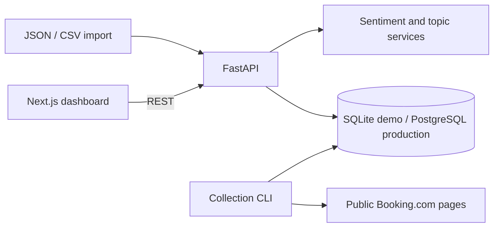

# Azzurro Review Intelligence

A production-oriented hotel review analytics platform for four Azzurro properties, built with FastAPI, SQLAlchemy, PostgreSQL-compatible storage and Next.js.

## Business problem
Hotel teams need to turn Booking.com guest feedback into property-level operational decisions, compare weekly performance and act on recurring complaints.

## Implemented
- Four centrally configured properties
- SQLite local/demo database and PostgreSQL-ready SQLAlchemy models
- Review import, deduplication, sentiment analysis and topic detection
- Sydney-timezone weekly analytics and property comparison
- REST API with Swagger documentation
- Next.js responsive hospitality dashboard
- Synthetic demonstration dataset clearly marked as synthetic
- Collection status/logging and responsible, opt-in Playwright collection shell

## Architecture


## Folder structure
```text
backend/app/models       SQLAlchemy models
backend/app/routers      FastAPI routes
backend/app/services     sentiment, topic and analytics services
backend/app/schemas      Pydantic schemas
backend/scraper           property config and responsible scraper
backend/data             synthetic demonstration JSON
backend/scripts          database/import utilities
frontend/app             Next.js App Router pages and styles
frontend/components      dashboard UI
frontend/lib             API client
```

## Responsible collection
Live Booking.com collection is opt-in via `python -m scraper.run --all --live`. The implementation never bypasses CAPTCHA, login, anti-bot protections or access restrictions and records blocked/failed access. Automated tests make no live requests.

## Database
Properties, reviews, collection logs and insights are defined in `backend/app/models/models.py`. Production should set `DATABASE_URL` to a PostgreSQL async URL such as `postgresql+asyncpg://...`. Review hash deduplication is unique per property.

## Analytics
The reporting week is Monday to Sunday in `Australia/Sydney`. Average ratings exclude invalid ratings. Topic percentages use review-level counts as numerator and the applicable negative-review count as denominator.

## Local setup
```bash
cd backend
python3 -m venv .venv
source .venv/bin/activate
pip install -r requirements.txt
python scripts/import_demo.py
uvicorn app.main:app --reload --port 8000
```

```bash
cd frontend
npm install
npm run dev
```

Configure `NEXT_PUBLIC_API_URL=http://localhost:8000` if needed.

## Import synthetic data
```bash
cd backend
python scripts/import_demo.py
```
The JSON records in `backend/data/demo_reviews.json` are fictional and marked with `source="synthetic"`.

## Scraper CLI
```bash
cd backend
python -m scraper.run --all
python -m scraper.run --property olympic
python -m scraper.run --all --live
```

## Tests
```bash
cd backend
pytest -q
```

## API
Swagger is available at `http://localhost:8000/docs`. Collection and import endpoints accept `X-Admin-Secret` when `ADMIN_SECRET` is configured.

## Environment variables
Copy `backend/.env.example` to `backend/.env`. Never commit secrets. Configure `CORS_ORIGINS`, `DATABASE_URL`, optional Groq/OpenAI keys and collection settings in the backend only.

## Deployment
- Frontend: Vercel (`frontend` directory), set `NEXT_PUBLIC_API_URL`.
- Backend: Render or another Python host, set PostgreSQL `DATABASE_URL`, CORS origin and admin secret.
- Demo: SQLite works locally but PostgreSQL is recommended for production.

## Screenshots


## Limitations
Live Booking.com HTML and access availability vary; collection is not guaranteed. Public pages may require browser consent or block automation. The scraper transparently reports failures rather than fabricating success. Transformer models are optional and the deterministic fallback is always available.

## Limitations
- Demo data is synthetic and labelled "Synthetic demo data"; not genuine Booking.com reviews.
- Live Booking.com collection is opt-in and requires Playwright browser dependencies; CAPTCHA/anti-bot blocks are recorded, not bypassed.
- SQLite is used for local/demo; production should use PostgreSQL via DATABASE_URL.
- Analytics week is Monday-Sunday in Australia/Sydney.
